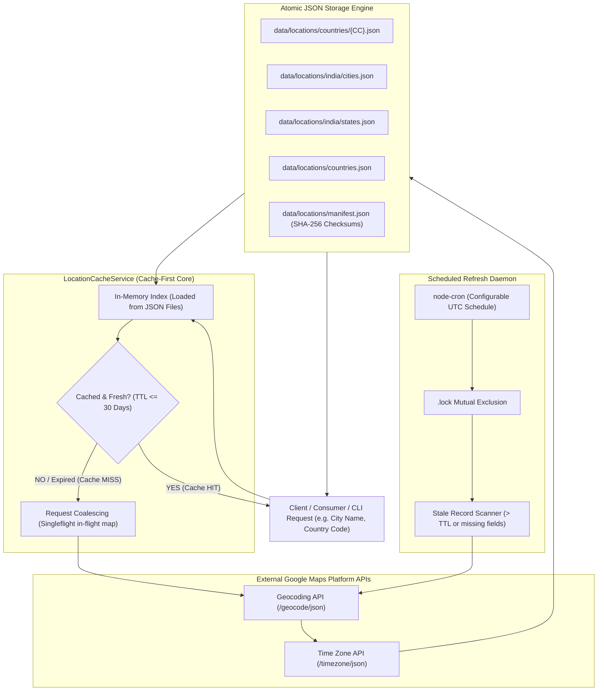

# Production-Ready Location Ingestion, Indexing & Caching Pipeline

A high-reliability, multi-tiered location resolution architecture in TypeScript and Node.js. It integrates a high-performance offline **GeoNames** open-data ingestion engine with an on-demand, cache-first **Google Maps Platform** API pipeline (Geocoding API and Time Zone API).

---

## Data Sources, Attribution & Legal Notice

### 1. GeoNames Bulk Dataset (CC BY 4.0)
* **Provider & Source:** [GeoNames (geonames.org)](https://www.geonames.org).
* **Licensing:** Licensed under the [Creative Commons Attribution 4.0 International (CC BY 4.0)](https://creativecommons.org/licenses/by/4.0/legalcode).
* **Modification Notice:** The raw GeoNames tabular dump (`IN.txt` and associated reference tables) was filtered (retaining populated places `P` and administrative divisions `A`), normalized into canonical JSON representations, partitioned into state/city files (`data/locations/india/`), and indexed with partitioned offset tables (`data/locations/india/.index/`).
* **Attribution Requirement:** Any redistribution or consumer display of this offline data must include attribution to `GeoNames (geonames.org)` and a link to the CC BY 4.0 license.

### 2. Google Maps Platform APIs (Proprietary)
* **Provider:** Google Cloud Platform — Google Maps Platform (Geocoding API and Time Zone API).
* **Coordinate Retention Limit:** In compliance with the *Google Maps Platform Service Specific Terms (Geocoding API)*, cached latitude and longitude coordinates may only be temporarily retained for up to **30 consecutive calendar days**, after which they must be deleted or re-requested.
* **Place ID Exemption:** Place ID values (`place_id`) are explicitly exempt from the 30-day caching restriction and may be stored indefinitely.
* **Prohibition on Non-Google Maps:** Under Google Maps Platform terms, Google-derived content (including geocoded coordinates and addresses) **must NOT be displayed on or in conjunction with any non-Google map** (such as Leaflet, OpenStreetMap, Mapbox, or MapLibre).
* **Display Attribution:** Consumer user interfaces presenting Google Maps content must visibly display the official **"Powered by Google"** logo.
* **Compliance Notice:** Adherence to Google Maps Platform terms requires both backend deletion of expired records and compliant client-side display behavior.

---

## Architecture Overview



---

## 1. Verified API Provider & Endpoints

### Provider
* **Provider:** **Google Cloud Platform — Google Maps Platform**
* **Authentication:** API key passed via query parameter (`key=...`) or header (`X-Goog-Api-Key`) over HTTPS.
* **Credentials:** Read securely from `.env` (`LOCATION_API_KEY`). The key is strictly redacted from all structured logs, error traces, and Git commits.

### Officially Supported Endpoints Used
1. **Geocoding API:**
   * **Endpoint:** `GET https://maps.googleapis.com/maps/api/geocode/json`
   * **Parameters:** `address={cityName}`, `components=country:{countryCode}`, `key={API_KEY}`
   * **Data Returned:** Unique stable `place_id`, formatted address, structured `address_components` (locality, state/province, country, ISO country code), and coordinates (`geometry.location.lat`, `geometry.location.lng`).
2. **Time Zone API:**
   * **Endpoint:** `GET https://maps.googleapis.com/maps/api/timezone/json`
   * **Parameters:** `location={lat},{lng}`, `timestamp={unix_epoch}`, `key={API_KEY}`
   * **Data Returned:** Authoritative IANA time zone identifier (e.g. `Asia/Kolkata`, `America/New_York`, `Asia/Tokyo`).

---

## 2. Cache-First Lookup Flow

The pipeline enforces strict cache-first resolution:

1. **Input Normalization:** Accepts `cityName` and optional `countryCode`. Normalizes characters (lowercased, diacritics stripped, trimmed).
2. **Deterministic Cache Key:** Constructs key in the format `{COUNTRY_CODE}:{CITY_NAME}` (e.g. `IN:mumbai`, `JP:tokyo`).
3. **Local Cache Inspection:** Checks the local index loaded from `data/locations/countries/*.json`.
4. **Cache Freshness Evaluation:**
   * If a record exists and is within `LOCATION_CACHE_TTL_DAYS` (default: 30 days):
     * Returns immediately with `status: 'HIT'`, `fromCache: true` (**0 external API calls**).
5. **Singleflight Request Coalescing:**
   * If multiple concurrent requests arrive for the exact same uncached location, the pipeline coalesces them so **only 1 external API call is initiated**. All callers await the identical in-flight promise.
6. **External Retrieval & Validation:**
   * Calls Google Geocoding API and Time Zone API with bounded retries and exponential backoff.
   * Validates WGS 84 coordinates ($-90 \le \text{lat} \le 90$, $-180 \le \text{lng} \le 180$) and schema compliance.
7. **Thread-Safe Atomic Persistence:**
   * Serializes file writes per country.
   * Writes updated JSON arrays to temporary files (`.tmp`), validates JSON envelope integrity, and atomically moves them to replace active files (`fs.renameSync`).
   * Updates `countries.json` and `manifest.json` with updated SHA-256 checksums.

---

## 3. Directory Layout & Canonical Schema

```
data/
  locations/
    countries.json               # Alphabetical index of processed countries & counts
    manifest.json                # Pipeline manifest with SHA-256 checksums
    .lock                        # Cross-process mutual exclusion lock
    .run-state.json              # Durable checkpoint state
    india/
      cities.json                # Filtered populated places in India (featureClass: 'P')
      states.json                # States and Union Territories of India (featureClass: 'A')
    countries/
      IN.json                    # Full India dataset
      US.json                    # Full United States dataset
      GB.json                    # Full United Kingdom dataset
      JP.json                    # Full Japan dataset
      ...                        # Dynamic per-country storage
```

### Canonical Record Schema
```json
{
  "id": "ChIJLbZ-NFv9DDkRzk0gTkm3wlI",
  "name": "New Delhi",
  "asciiName": "New Delhi",
  "countryCode": "IN",
  "countryName": "India",
  "admin1Code": "DL",
  "admin1Name": "Delhi",
  "admin2Code": null,
  "featureClass": null,
  "featureCode": null,
  "types": [
    "locality",
    "political"
  ],
  "latitude": 28.6139298,
  "longitude": 77.2088282,
  "timezone": "Asia/Calcutta",
  "population": null,
  "elevation": null,
  "modificationDate": null,
  "source": "google-maps",
  "updatedAt": "2026-10-17T12:59:12.282Z"
}
```

---

## 4. Initial Population & Seed Catalog

Google Maps Platform does not provide a bulk downloadable dump of global cities. To prevent 100% initial cache misses in production, the pipeline includes a curated seed catalog (`src/seed/index.ts`):
* **India:** Over 60 metropolitan centers, state capitals, union territories, and tier-1/tier-2 populated places (Mumbai, New Delhi, Bengaluru, Hyderabad, Chennai, Kolkata, Pune, Ahmedabad, etc.).
* **Major Countries:** Top cities across the US, UK, Canada, Australia, Germany, France, Japan, Brazil, and China.
* **On-Demand Expansion:** Any location not in the seed list is dynamically fetched upon first request, cached indefinitely (or up to TTL), and served from disk thereafter.

---

## 5. Cron Scheduled Maintenance (Permitted Compliance Pruning)

* **Schedule:** Configurable via `LOCATION_CRON_SCHEDULE` (Default: `0 3 * * 0` — Sunday at 03:00 UTC).
* **Compliance Maintenance Only:** In strict compliance with Google Maps Platform Terms of Service Section 3.2.3(a) and Geocoding Service-Specific Terms, the background cron daemon does **NOT** autonomously re-fetch coordinates from Google without an active user request.
* **Permitted Action:** The cron job inspects all cached records and **prunes expired records** whose age exceeds `LOCATION_CACHE_TTL_DAYS` (30 calendar days). This fulfills the mandatory Google ToS requirement that customers must "delete or re-request" cached coordinates after 30 days. Re-requesting is strictly deferred until a genuine, user-initiated lookup occurs.
* **Concurrency Locking:** Acquires PID-based `.lock` with stale threshold safety (>24h) to prevent overlapping cron runs.
* **Zero Unprompted API Calls:** The scheduled maintenance job makes exactly **0 external API calls**.

---

## 6. Execution Commands

### Cache-First Location Lookup
```bash
# Initial request -> Cache MISS -> Fetches from Google API -> Caches to JSON
npm run lookup -- "Mumbai" --country IN

# Subsequent request -> Cache HIT -> Serves from JSON (0 API calls)
npm run lookup -- "Mumbai" --country IN
```

### Run Cache Maintenance Pruning (Google ToS Compliance)
```bash
# Prunes expired records older than 30 days (0 API calls)
npm run prune
```

### Administrative On-Demand Refresh
```bash
# Manual administrative refresh (User-initiated only)
npm run refresh
```

### Launch Scheduler Daemon
```bash
npm run schedule
```

### GeoNames Large Offline Dataset Ingestion (CC-BY 4.0 Open Data)
```bash
# Ingest full global dataset or specific countries offline:
npm run import:full
npm run import:country -- --country IN
```

### Check Cache Status & Metrics
```bash
npm run status
```

---

## 7. Verification & Automated Testing

All unit, cache-first, request coalescing, and integration test suites run offline via mocked responses with zero network dependencies.

```bash
# Run test suite
npm test

# Build TypeScript
npm run build
```

### Test Suite Highlights
* **Test A (Initial Miss):** Uncached location triggers API client and persists record to JSON.
* **Test B (Repeated Lookup):** Identical request returns from cache; API request counter does **not** increment.
* **Test C (Collision Resistance):** Distinct locations generate unique cache keys without cross-contamination.
* **Test D (Freshness & TTL):** Fresh records bypass API; expired records trigger controlled refresh.
* **Test E (API Failure Protection):** Network or 5xx failures do not corrupt existing disk cache; stale records returned gracefully.
* **Test F (Selective Refresh):** Cron refresh only contacts external API for expired records, skipping fresh records.
* **Test G (Singleflight Coalescing):** Multiple concurrent misses collapse into a single external network request.

---

## 8. Google Maps Platform Terms of Service & Legal Analysis

### Official Terms Breakdown (Section 3.2.3 & Service-Specific Terms)
1. **Place ID Retention:**
   * **Permitted:** Place ID values (`place_id`) are explicitly exempt from caching restrictions and may be stored indefinitely.
2. **Geocoding API (Latitude & Longitude):**
   * **30-Day Retention Limit:** Customer may cache latitude and longitude values from the Geocoding API for **up to 30 consecutive calendar days**, after which customer must **delete** or **re-request** the cached values.
   * `LOCATION_CACHE_TTL_DAYS` is set to `30` to enforce this upper boundary.
3. **Time Zone API (Time Zone ID):**
   * **Tied to 30-Day Cache:** Time zone IDs (`timeZoneId`) and offset metadata returned by the Google Maps Time Zone API constitute Google Content and cannot be retained permanently as an independent lookup database. They are purged alongside coordinates after 30 days.
4. **No Pre-Fetching / Mass Harvesting (Section 3.2.3(a)):**
   * Pre-fetching, background indexing, or bulk downloading of Google Content without an active user request violates Section 3.2.3(a).
   * **Compliance Implementation:** The scheduled cron daemon (`src/scheduler/index.ts`) does **NOT** autonomously re-fetch Google content in the background. Instead, it performs **compliance pruning** (`pruneExpiredRecords`), deleting cached records that have reached 30 days without an eligible request. Re-fetching occurs strictly on-demand when an active user query arrives.
5. **Attribution, Display & Non-Google Maps Restrictions:**
   * Under Section 3.2.2 and the Geocoding API Service Specific Terms (*Use without a Google Map*), Geocoding API results may be used in backend services and non-map interfaces (e.g., text-only location displays or address forms).
   * **Strict Non-Google Maps Prohibition:** Google Maps Content (including geocodes, coordinates, and formatted addresses) **must NEVER be displayed on or in conjunction with a non-Google map** (such as Leaflet, OpenStreetMap, Mapbox, or MapLibre).
   * **Required UI Logo:** Any visual display of Google content must feature the official **"Powered by Google"** logo.
   * **Compliance Caveat:** Full legal compliance cannot be established solely by backend caching logic; the consuming application must guarantee compliant client-side display and mapping practices.
6. **10-Million Global Dataset Limitation:**
   * Harvesting 10 million records through Google Maps Geocoding API is both legally prohibited (violates anti-scraping/pre-fetching clauses) and commercially prohibitive ($32.00 per 1,000 requests = **$320,000 USD** for 10M lookups, plus Time Zone API costs).
   * **Independent Open-Data Pipeline:** For complete global and national offline city databases, the project maintains a separate, dedicated ingestion pipeline (`npm run import:full`) powered by **GeoNames (CC-BY 4.0)**, preserving full attribution and open redistribution rights without proprietary API restrictions.

---

## 9. Scheduler Production Deployment Guide

The local scheduler implementation (`src/scheduler/index.ts`) uses `node-cron` with UTC execution and cross-process file locking (`.lock`). **It is currently verified in the local development environment and has not yet been deployed live to production.**

### Recommended Production Deployment Architectures:
1. **Containerized Daemon (Docker / Kubernetes):**
   * Package as a long-running container service:
     ```dockerfile
     CMD ["npm", "run", "schedule"]
     ```
   * Mount a persistent volume for `data/locations/` to preserve the cache across container restarts.
2. **Kubernetes CronJob / Cloud Scheduled Task:**
   * Run an ephemeral task on a weekly schedule (`0 3 * * 0`):
     ```bash
     node dist/index.js refresh
     ```
   * Advantages: Zero idle resource cost, automatic timeout management, native cloud observability.
3. **Systemd Service (Linux Server):**
   * Create `/etc/systemd/system/location-scheduler.service` with `Restart=always` and `User=appuser`.

